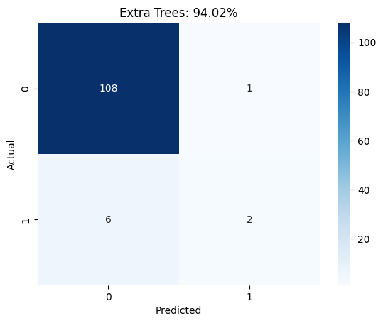
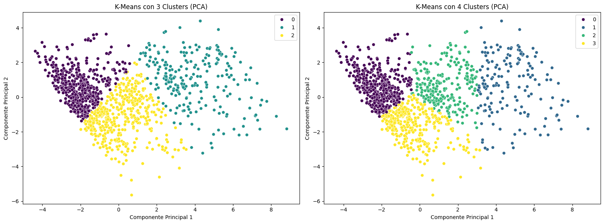

# Predicción de demencia en adultos con machine learning

[](https://colab.research.google.com/github/CesarGuarecuco/Dementia-Prediction/blob/main/prediccion_demencia.ipynb) [](https://nbviewer.org/github/CesarGuarecuco/Dementia-Prediction/blob/main/prediccion_demencia.ipynb)

Proyecto académico (2024). Predice si un adulto tiene demencia a partir de variables clínicas y de pruebas cognitivas. El reto principal es el desbalance: solo 7% de los pacientes tiene demencia, así que un modelo que siempre dice "no" ya acierta 93%.

## Resultado

Ningún modelo detecta bien la clase minoritaria, y el notebook lo muestra con las métricas correctas en vez de quedarse con la exactitud.

| Modelo | Exactitud | Recall (demencia) | F1 (demencia) |
| --- | --- | --- | --- |
| Extra Trees | **94%** | 25% | **0,36** |
| SVC | 88% | 50% | **0,36** |
| Random Forest | 91% | 25% | 0,27 |
| AdaBoost | 62% | **88%** | 0,24 |
| Red neuronal (PyTorch) | 91% | 13% | 0,20 |
| XGBoost | 90% | 13% | 0,14 |

Cómo leerlo: Extra Trees es el más preciso en general, pero AdaBoost encuentra 7 de los 8 casos de demencia a cambio de muchas falsas alarmas. Para un tamizaje, donde lo grave es no detectar un caso, AdaBoost es la mejor opción. El conjunto de prueba tiene solo 8 casos positivos, así que estas cifras son orientativas.



## Qué incluye el notebook

1. Análisis exploratorio y tratamiento de valores faltantes.
2. Agrupamiento con K-Means (método del codo, 3 y 4 grupos, visualización con PCA).
3. Escalado con MinMaxScaler y balanceo de clases con SMOTE.
4. Random Forest, Extra Trees, AdaBoost, SVC, XGBoost y una red neuronal en PyTorch.
5. Comparación con matriz de confusión, precisión, recall y F1, y guardado de los modelos.



## Datos

Dataset clínico público de Kaggle (`Dementia.csv`). No se incluye en el repositorio: déjalo junto al notebook.

## Cómo ejecutarlo

```bash
pip install -r requirements.txt
jupyter notebook prediccion_demencia.ipynb
```

---

¿Necesitas un análisis o un modelo como este con los datos de tu organización? [Sivax Intelligence](https://sivax-intelligent.netlify.app/) · [sivax.contacto@gmail.com](mailto:sivax.contacto@gmail.com)
